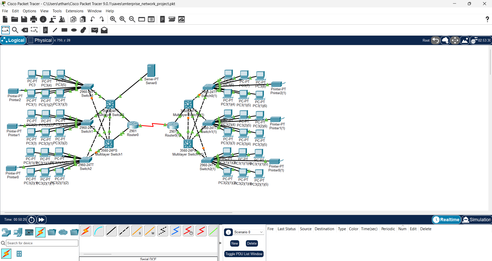

# Two-Site Enterprise Network

A simulated office network built in Cisco Packet Tracer. It connects two locations and gives their PCs access to a shared server, with backup gateways if a multilayer switch becomes unavailable.

I started with a tutorial for the topology, then used a custom addressing plan and worked through the configuration and troubleshooting. My goal was to understand how VLANs, routing, redundancy, and network services work together.



## What I built

- 2 routers connecting the sites
- 4 multilayer switches providing routing and backup gateways
- 6 access switches connecting 36 PCs and 6 printers
- 1 server providing DHCP, DNS, and an internal website

Each access switch connects to both multilayer switches at its site. This gives devices an alternate path if a connection fails.

## How it works

| Feature | Purpose |
|---|---|
| VLANs | Divide the PCs into six separate networks, with another network for the server. |
| Trunk links | Carry multiple VLANs between switches over the same cable. |
| Inter-VLAN routing | Allows devices in different VLANs to communicate. |
| HSRP | Provides a shared gateway address that a backup switch can take over. |
| Spanning Tree | Prevents loops caused by the extra switch connections. |
| OSPF | Shares routes between the routers and multilayer switches so both sites can communicate. |
| DHCP and relay | Let one server automatically assign PC addresses across both sites. |
| DNS and HTTP | Let users open the server’s website using `intranet.example.com`. |

The VLANs separate broadcast traffic. Access restrictions between VLANs are outside the current scope.

## IP addressing

| VLAN | Location | Subnet | Gateway |
|---|---|---|---|
| 10 | Left, top group | 192.168.10.0/24 | 192.168.10.1 |
| 20 | Left, middle group | 192.168.20.0/24 | 192.168.20.1 |
| 30 | Left, bottom group | 192.168.30.0/24 | 192.168.30.1 |
| 40 | Right, top group | 192.168.40.0/24 | 192.168.40.1 |
| 50 | Right, middle group | 192.168.50.0/24 | 192.168.50.1 |
| 60 | Right, bottom group | 192.168.60.0/24 | 192.168.60.1 |
| 70 | Server | 192.168.70.0/24 | 192.168.70.1 |

Each VLAN uses the same pattern:

- `.1` is the shared gateway.
- `.2` and `.3` belong to the two multilayer switches.
- PCs receive addresses from `.100` through `.199` in the six client VLANs.

The server has a static address of `192.168.70.10`. Router links use separate `/30` subnets within `10.0.0.0/16`.

## What I tested

- PCs receiving addresses through DHCP
- OSPF neighbors reaching the FULL state
- A right-side PC reaching the server at the left site
- Opening the internal website by hostname
- Gateway failover and recovery on the right side

For the failover test, I disabled the top-right multilayer switch’s network connections. The bottom switch became the active gateway, and the test PC could still reach the server after the network settled. When I restored the connections, the top switch took over again.

## What I learned

Troubleshooting was a large part of this project. I fixed missing VLAN interface configuration, checked which links carried the server VLAN, configured serial clocking, and investigated a problem with traffic using the shared gateway.

One useful lesson was that a successful ping from a switch doesn’t necessarily mean a PC can reach the same destination. Testing from the actual client helped narrow down the problem.

## Skills demonstrated

This project gave me hands-on practice with Cisco configuration, IP addressing, and connecting multiple networks. It demonstrates my ability to:

- Configure VLANs, trunks, routing, and shared network services.
- Set up backup gateways and test how the network responds to a failure.
- Troubleshoot connectivity using CLI commands and tests from end devices.
- Document a network’s design, test results, and limitations.

Building and troubleshooting the network helped me understand how traffic travels from a PC, through its gateway and the site routers, to the server and back.

## Try it

1. Download `enterprise-network.pkt` and open it in Cisco Packet Tracer.
2. Select Realtime mode and allow routing and gateway protocols to settle.
3. From a PC, ping `192.168.70.10`.
4. Open `http://intranet.example.com` in the PC’s browser.

Useful verification commands include:

```text
show vlan brief
show interfaces trunk
show ip interface brief
show standby brief
show ip ospf neighbor
show ip route
```

## Limitations

This is a lab simulation with no Internet connection or firewall rules. It has redundant gateways, but each site still depends on one router, and the sites share one serial link.

The server has one connection to the top-left multilayer switch, so losing that switch also disconnects the server. Automatic HSRP failover based on router-uplink status is not configured.
